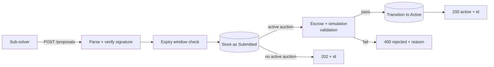
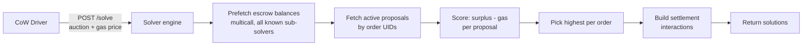
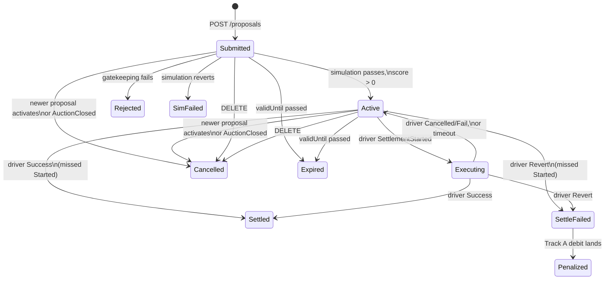

# Service architecture

The off-chain component of BYOS: a single-process service that ingests sub-solver proposals, validates them against the chain, scores them, and answers the CoW driver's `/solve` endpoint with candidate solutions.

Two implementations exist — a [Rust service](https://github.com/bleu/byos-service) and a [TypeScript migration](https://github.com/bleu/byos-service-ts). This page describes the shared architecture; implementation-specific ADRs live in each repo.

## Two-listener model

The service binds two ports on one process, with opposite trust boundaries:

| Listener | Default port | Serves | Trust level |
|---|---|---|---|
| **Public** | 9585 | `/proposals` (POST), `/proposal/:id` (GET, DELETE), `/proposals/by-sub-solver` (GET), `/proposals/:orderUid` (GET), `/buffer-balance` (GET) | Internet-reachable |
| **Internal** | 9586 | `/solve`, `/notify` | Firewalled, driver-only |

They never share a socket. A `/solve` response contains the full standing proposal book for an auction — amounts, routes, and signatures, all MEV-relevant — so it must not be reachable from the public internet. An optional bearer token on `/solve` provides defense in depth.

## Request flow

### Proposal ingestion (public)



The request path parses the proposal, verifies the signature, checks the expiry window, and runs escrow and simulation validation synchronously. A `200` response means the proposal is active in the current auction. A `400` response means it was rejected with a typed reason. A `202` response means the proposal was stored but no active auction is running.

For EOA sub-solvers the signature verification is a pure `ecrecover` — no RPC, no state. For contract sub-solvers (`subSolverAddress` present in the POST body) the service tries `ecrecover` first; if that does not match the declared address it falls back to one `eth_call` invoking `isValidSignature` on the contract. See [`#proposal-schema`](#proposal-schema).

### Solving (internal)



`/solve` is the hot path — **no RPC, no simulation, no writes** beyond recording the solution-to-proposal mapping. It reads from Postgres (indexed by order UID), scores with cached gas estimates, computes CREATE2 addresses locally, and ABI-encodes the two interactions (transfer + execute). Target latency: p99 < 100ms.

### Settlement outcomes (internal)

The CoW driver notifies BYOS of outcomes via `POST /notify`. There is no chain watcher and no driver fork.

| Notification | Proposal transition |
|---|---|
| `SettlementStarted` | `Active` → `Executing` |
| `Success { transaction }` | `Active` or `Executing` → `Settled` |
| `Revert { transaction }` | `Active` or `Executing` → `SettleFailed` (triggers Track A debit) |
| `Cancelled` / `Expired` / `Fail` | `Executing` → `Active` (queues non-settlement debit) |

`/notify` joins to proposals through the `(auction_id, solution_id, proposal_id)` mapping that `/solve` records synchronously before returning solutions.

## Background workers

Three background loops run alongside the HTTP listeners:

### Stale-executing sweep

Runs every ~5 minutes. Transitions proposals stuck in `Executing` for more than `EXECUTING_TIMEOUT_SECS` (default 5 minutes) back to `Active`. Handles lost notifications and service restarts.

Validation does not run in a background loop. Escrow and simulation checks run synchronously on the `POST /proposals` request path. See [Proposal ingestion](#proposal-ingestion-public).

### Penalty loop

Runs on the same interval as validation. Processes Track A debits and post-settlement buffer accounting:

1. For each `SettleFailed` proposal: fetch settlement tx receipt, compute `gas_used × effective_gas_price + frozen c_l`, call `escrow.debit(subSolver, amount, txHash)`.
2. For each pending non-settlement debit: call `escrow.debit(subSolver, 0.1 × frozen c_l, orderUidHash)`.
3. **Buffer ledger** — for each `Settled` proposal where `minBuyAmount < quoteBuyAmount` and no ledger entry exists yet: read the `Executed` event's `delta` from the settlement tx receipt, compute the signed gap (`quoteBuyAmount − delta`), convert to native token at the auction's reference price (stored in the `solutions` table), and insert a `buffer_entries` row. Positive entries mean under-delivery (debit); negative entries mean over-delivery (credit). Over-delivery credits offset future shortfalls but are never paid out. Then, for each affected sub-solver: sum uncleared entries. If the outstanding balance exceeds `c_l`, debit the full balance from escrow in one transaction, mark all entries as cleared, and emit a `bufferDebited` audit event.
4. On success: transition to `Penalized` (for Track A), record the debit tx hash.
5. Retry up to 10 times on transient failures, then park for operator investigation.

### Retention sweep

Runs every ~5 minutes. Removes terminal proposals (`Rejected`, `SimFailed`, `Expired`, `Cancelled`) from the active store once they have been in their terminal state for more than 1 hour. Money states (`Settled`, `SettleFailed`, `Penalized`) are never swept — they are dispute evidence.

Swept proposals are not lost: every proposal is mirrored to a permanent `proposals_log` table by a database trigger. `GET /proposal/{id}` falls back to that log automatically, and the list endpoints accept `?includeArchived=true` to query it directly.

## Proposal lifecycle



A state answers one question: **what does the service do with this proposal right now?**

| State | Simulated? | Offered to `/solve`? | Cancellable? |
|---|---|---|---|
| `Submitted` | Inline on POST | No | Yes |
| `Active` | No | Yes | Yes |
| `Executing` | No | No | No |
| `Rejected` / `SimFailed` / `Expired` / `Cancelled` | No | No | No |
| `Settled` / `SettleFailed` / `Penalized` | No | No | No |

`POST /proposals` uses `(subSolver, nonce)` as its idempotency key. An identical signed replay returns the original id with `202` and has no side effects; different signed content for the same key returns `409 NonceAlreadyUsed`.

When a proposal is still the newest eligible submission and validates, one serialized group transaction activates it and cancels older `Submitted` or `Active` proposals for the same `(subSolver, orderUid)`. It never cancels `Executing` proposals and prevents a late older validator from reactivating stale work.

Transitions are **compare-and-swap** — zero rows affected means the caller's verdict was stale (a cancellation, replacement, or notification won the race).

## Persistence

Postgres is the source of truth:

| Table | Purpose | Retention |
|---|---|---|
| `proposals` | Current state — read by `GET`, `/solve`, `/notify`, and the validator | Live proposals indefinite; terminal states swept after 1 hour (except money states) |
| `audit_events` | Append-only history — what happened, when, why | No deletion path. Dispute evidence for Track B claims arriving up to 3 months later. |
| `solutions` | Attribution mapping `(auction_id, solution_id) → proposal_id`. Also stores the buy token's reference price from the auction for post-settlement buffer accounting. | Indefinite |
| `buffer_entries` | Signed ledger of per-proposal buffer amounts for proposals using loose slippage (`minBuyAmount < quoteBuyAmount`). Each entry records the buy token, the gap between `quoteBuyAmount` and the delivered `delta`, converted to native token. Entries accumulate until the balance exceeds `c_l`, then are cleared in batch. Indexed by `(sub_solver, cleared)` and `proposal_id`. | Indefinite |
| `penalties` | Pending non-settlement debits (queued by `Cancelled`/`Expired`/`Fail` notifications) | Processed by the penalty loop, then retained |

The audit trail uses a write-behind pattern: events are emitted after their proposal write commits, persisted by a dedicated background worker. This decouples audit codec evolution from the store's hot path. The crash window (state change committed, audit event not yet persisted) is accepted at one event per crash.

## Scoring

```
score = surplus - gas
```

- **Surplus**: improvement beyond the order's limit price (extra buy tokens on a sell order, sell tokens kept back on a buy order), computed from `quoteBuyAmount` and converted at the auction's reference price.
- **Gas**: simulated `eth_estimateGas` result + 30k buffer, times the auction's effective gas price.

There is no fee term. CoW's score is `surplus + protocol fees`, and the protocol fee cancels out of ranking. Once the gas cut equals the gas cost, `surplus - gas` matches what the autopilot computes.

BYOS's score is a **pre-ranking** that decides which proposals deserve the driver's encoding budget. The driver re-scores after encoding and simulation.

## Gas cut

BYOS keeps the estimated gas cost of each settlement, in the order's sell token, as its revenue. It is declared as the fulfillment's `fee` field — a price wedge, not a deduction from the route.

```
effective_gas = gas_used + 30k buffer
cut_in_wei = effective_gas × effective_gas_price
cut_in_sell_tokens = ceil(cut_in_wei × 10^18 / sell_token_price)
```

The cut is **not padded** — a larger cut lowers the score, which lowers CIP-85 consistency rewards. A proposal is skipped if the cut would breach the user's signed limit.

## Key design decisions

Rationale for each decision lives in the ADRs of [byos-service](https://github.com/bleu/byos-service/tree/main/docs/adr) and [byos-service-ts](https://github.com/bleu/byos-service-ts/tree/main/docs/adr). This section summarizes the final state.

### Sync ingestion

The request path validates proposals synchronously (escrow + simulation). A `200` means active; `400` means rejected. `202` means stored but no active auction is running.

### No chain watcher

Settlement outcomes come from the stock CoW driver's `/notify` endpoint, not from scanning blocks. This covers private submissions and dropped transactions that a block scanner would miss. Missed-deadline detection comes free from `Cancelled` and `Expired` notifications.

### Owner-scoped reads

All `GET` endpoints require an EIP-712 signature, and the recovered signer scopes the response. Non-owners get `404`, not `403`, to prevent existence-oracle attacks.

### First-revert-terminal simulation

A proposal that fails simulation once is not re-simulated.

### Profitability gate on first validation only

A score of zero or less rejects as `Unprofitable` on the first simulation, matching `/solve`'s inclusion rule. It is not re-applied on re-validation — gas prices wobble, and rejecting on a spike would churn proposals that are profitable again two blocks later.

### Proposal lifetime cap

`validUntil` more than 5 minutes in the future is rejected at ingestion. This bounds worst-case simulation cost per proposal and guarantees the expiry sweep arrives within a known window.

### One sub-solver per settlement transaction

The per-sub-solver Trampoline CREATE2 address in the calldata identifies which sub-solver's route ran. The driver's `SolutionMerging` is set to `Forbidden` to prevent silent batching.

### Compare-and-swap transitions

All state transitions check the expected current state before updating. Zero rows affected means a concurrent transition won — a cancellation, a notification, or an expiry sweep raced and won. No stale overwrites.

Penalty caps are frozen with auction attribution before bidding. Revalidation
prices are separate from auction evidence; legacy unsnapshotted events use
`MIN_COLLATERAL`. Retention preserves unresolved penalty evidence. Buffer clearing
charges the full net debt only above `MIN_COLLATERAL / 5`; negative credits never
increase collateral available for gas or Track A penalties.
