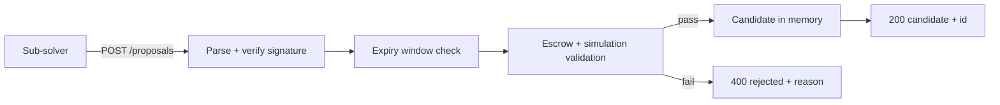
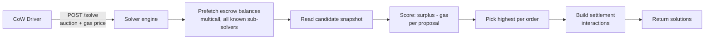

# Service architecture

The off-chain component of BYOS: a single-process service that ingests sub-solver proposals, validates them against the chain, scores them, and answers the CoW driver's `/solve` endpoint with candidate solutions.

Two implementations exist — a [Rust service](https://github.com/bleu/byos-service) and a [TypeScript migration](https://github.com/bleu/byos-service-ts). This page describes the shared architecture; implementation-specific ADRs live in each repo.

## Two-listener model

The service binds two ports on one process, with opposite trust boundaries:

| Listener | Default port | Serves | Trust level |
|---|---|---|---|
| **Public** | 9585 | `/proposals` (POST), `/proposal/:id` (GET, DELETE), `/proposals/by-sub-solver` (GET), `/proposals/:orderUid` (GET), `/buffer-balance` (GET) | Internet-reachable |
| **Internal** | 9586 | `/solve`, `/notify` | Firewalled, driver-only |

They never share a socket. A `/solve` response contains the full standing proposal book for an auction — amounts, routes, and signatures, all MEV-relevant — so it must not be reachable from the public internet. An optional bearer token on `/solve` provides defense in depth.

## Request flow

### Proposal ingestion (public)



`POST /proposals` checks the signature, expiry, escrow, order envelope, and simulation before returning. A `200` means the proposal is a candidate. A `400` means it failed validation or the auction is unavailable. Candidates remain in memory until selection; a restart loses them.

Before simulation, require `effectiveBalance >= MIN_COLLATERAL`. After simulation, check exposure against the available collateral. Admission is concurrent and can exceed escrow; see [collateral gates](design-document#collateral-gates-and-deployment-penalty-cap).

For EOA sub-solvers the signature verification is a pure `ecrecover` — no RPC, no state. For contract sub-solvers (`subSolverAddress` present in the POST body) the service tries `ecrecover` first; if that does not match the declared address it falls back to one `eth_call` invoking `isValidSignature` on the contract. See [`#proposal-schema`](#proposal-schema).

### Solving (internal)



`/solve` scores the candidate snapshot with cached gas estimates and picks one proposal per order. It writes selected proposals to `proposals` and unselected candidates to `proposals_log` before returning. The proposal ID is the solution ID. No route simulation runs on this path. Target latency: p99 < 100ms.

### Settlement outcomes (internal)

Driver cancellations use `settleFailed / DriverCancelled`; mined reverts use `settleFailed / SettlementReverted`. A cancellation requires matching start and abandonment evidence before the non-settlement debit is eligible. Late confirmed outcomes can correct it. Preserve signed or landed debit evidence for reconciliation.

The CoW driver reports outcomes through `POST /notify`. BYOS uses the proposal ID to look up the live row, then the permanent log. See [settlement outcomes](design-document#settlement-outcomes) for notification handling and late corrections.

## Background workers

### Outcome worker

Every `OUTCOME_WORKER_INTERVAL_SECS` (default 60 seconds), check submitted proposals that have waited about two minutes. A recent on-chain `Trade` event gives `Lost/SolverOutbid`; no event gives `Lost/UnknownOutput`. Late driver outcomes can correct either result. A missing outcome alone does not prove that a penalty is due.

### Penalty loop

Processes Track A debits and post-settlement buffer accounting:

1. For each `settleFailed` / `SettlementReverted` proposal (including legacy null reasons with a settlement hash): fetch settlement tx receipt, compute `gas_used × effective_gas_price + frozen c_l`, call `escrow.debit(subSolver, amount, txHash)`.
2. For each pending non-settlement debit: call `escrow.debit(subSolver, 0.1 × frozen c_l, orderUidHash)`.
3. **Buffer ledger** — for each `Settled` proposal where `minBuyAmount < quoteBuyAmount` and no ledger entry exists yet: read the `Executed` event's `delta` from the settlement tx receipt, compute the signed gap (`quoteBuyAmount − delta`), convert to native token at the auction's reference price (stored in the `proposals_log` row), and insert a `buffer_entries` row. Positive entries mean under-delivery (debit); negative entries mean over-delivery (credit). Over-delivery credits offset future shortfalls but are never paid out. Then, for each affected sub-solver: sum uncleared entries. If the outstanding balance exceeds `MIN_COLLATERAL / 5`, debit the full balance from escrow in one transaction, mark all entries as cleared, and emit a `bufferDebited` audit event.
4. After a Track A debit succeeds, set `proposals_log.penalty_tx_hash`. Keep the proposal status unchanged.
5. Retry up to 10 times on transient failures, then park for operator investigation.

## Proposal lifecycle

| State | Location | Cancellable? |
|---|---|---|
| `Candidate` | Memory, until selection | Yes |
| `Submitted` | `proposals`, until an outcome | No |
| Terminal outcome | `proposals_log` | No |

Terminal rows leave `proposals` immediately. Reads fall back to `proposals_log`, which retains the outcome. See [the state diagram and transitions](design-document#proposal-lifecycle).

## Persistence

| Table | Purpose |
|---|---|
| `proposals` | Submitted proposals awaiting an outcome |
| `proposals_log` | Permanent proposal history, including terminal outcomes and auction prices |
| `audit_events` | Append-only event history and dispute evidence |
| `buffer_entries` | Signed delivery gaps; clear net debt above `MIN_COLLATERAL / 5` |
| `debit_operations` | Durable escrow debit queue; `proposals_log.penalty_tx_hash` records completion |
| `settlement_attempts`, `settlement_attempt_members`, `settlement_notifications` | Attributed start, abandonment, and chain-outcome evidence |

Audit events are written by a background worker after the proposal write commits. A crash between those writes can leave a state change without its audit event.

## Scoring

`score = surplus - gas`. Calculate surplus from `effectiveBuyAmount = min(simulationBuyAmount, quoteBuyAmount)` and the order's limit, using auction reference prices. Gas is the simulated estimate plus the configured overhead, multiplied by the auction gas price. The driver applies protocol fees and scores the encoded solution again.

## Gas cut

Keep the estimated settlement gas cost in sell-token atoms:

```
cut_in_wei = (gas_used + gas_overhead) * effective_gas_price
cut_in_sell_tokens = ceil(cut_in_wei * 10^18 / sell_token_price)
```

Return the cut in the fulfillment's `fee` field. Skip a proposal if the cut would exceed the user's signed limit. See [gas accounting](design-document#gas).

## Key design decisions

### Sync ingestion

`POST /proposals` validates once and returns `200` for a candidate or `400` for rejection. The candidate store does not enforce nonce uniqueness or return the original ID on replay. Use a new nonce for each new route; the Trampoline enforces replay protection on-chain.

### No chain watcher

The driver supplies settlement outcomes. There is no continuous block scanner. The outcome worker checks recent on-chain trades when a notification is missing. Late notifications can correct the provisional `lost` state.

### Owner-scoped reads

All `GET` endpoints require an EIP-712 signature, and the recovered signer scopes the response. Non-owners get `404`, not `403`, to prevent existence-oracle attacks.

### First-revert-terminal simulation

A proposal that fails simulation once is not re-simulated.

### Profitability gate

A score of zero or less rejects as `Unprofitable` at validation and selection.

### Proposal lifetime cap

`validUntil` more than 5 minutes in the future is rejected at ingestion. This limits how long a signed route remains valid.

### One sub-solver per settlement transaction

The per-sub-solver Trampoline CREATE2 address in the calldata identifies which sub-solver's route ran. The driver's `SolutionMerging` is set to `Forbidden` to prevent silent batching.

### Compare-and-swap transitions

All state transitions check the expected current state before updating. Zero rows affected means a concurrent transition won — a notification or outcome worker completed first. No stale overwrites.

Penalty caps are frozen with auction attribution before bidding. Validation
prices are separate from auction evidence; legacy unsnapshotted events use
`MIN_COLLATERAL`. Retention preserves unresolved penalty evidence. Buffer clearing
charges the full net debt only above `MIN_COLLATERAL / 5`; negative credits never
increase collateral available for gas or Track A penalties.
